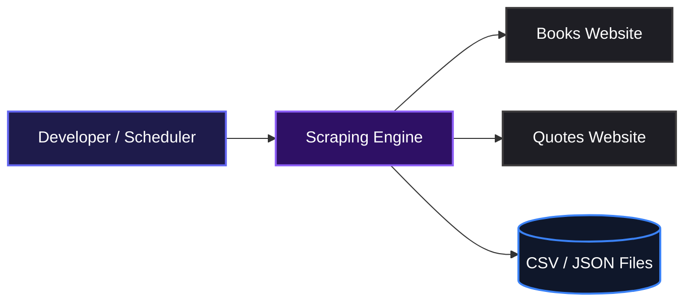
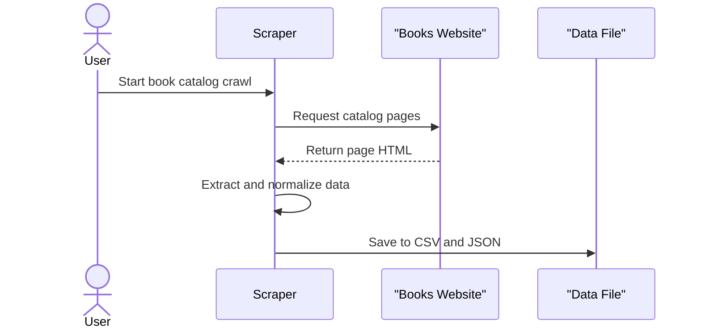
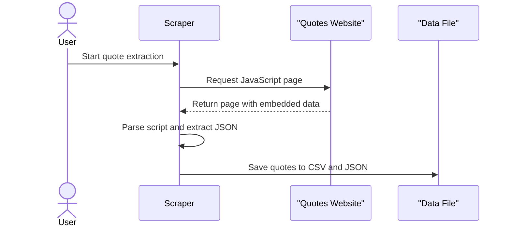

# Web Scraping Toolkit: Books & Quotes Scraper

Automated data collection from popular scraping practice sites, exported to clean CSV and JSON datasets.

## Overview

This project helps developers collect structured book and quote data from popular practice scraping sites without manual copying or browser extensions. It turns messy web pages into clean, analysis-ready datasets that can be exported to CSV or JSON. Teams can use it to build datasets for machine learning, price monitoring, or content aggregation projects.

## System Architecture



## Features

### Automated Book Catalog Scraping

Crawls the entire book catalog across multiple pages, extracts the title, price, star rating, availability, and full URL for each book, then exports everything to CSV and JSON.



### Dynamic Quote Extraction

Pulls quotes embedded in JavaScript data objects, normalizes nested author fields, converts tag lists into readable strings, and exports the results to CSV and JSON.



### Structured Export and Quality Checks

Every scraper saves results to both CSV and JSON, then prints the dataset shape, a preview, and a missing-value summary so you can verify completeness at a glance.

## Installation

1. Clone the repository:

```bash
git clone https://github.com/Adeyiwolasuccess/Codveda_Internship.git
```

2. Move into the project folder:

```bash
cd Codveda_Internship
```

3. Create a virtual environment:

```bash
python -m venv venv
```

4. Activate the environment:

```bash
# macOS / Linux
source venv/bin/activate

# Windows
venv\Scripts\activate
```

5. Install the dependencies:

```bash
pip install requests beautifulsoup4 pandas urllib3
```

## Usage

Run the book scraper:

```bash
python scraper.py
```

Run the quote scraper:

```bash
python dynamic_scraper.py
```

Each script creates two output files in the project root:

- `./books.csv` and `./books.json` from [`scraper.py`](./scraper.py)
- `./quotes.csv` and `./quotes.json` from [`dynamic_scraper.py`](./dynamic_scraper.py)

Running the book scraper produces output similar to the following:

```text
page 1: 20 books so far
page 2: 40 books so far
...
(1000, 5)
                                               title  price  rating availability                                               link
0  A Light in the Attic                               51.77       3     In stock  http://books.toscrape.com/catalogue/a-light-in-the-attic_1000/index.html
```

Running the quote scraper produces output similar to the following:

```text
page 1: 10 quotes so far
page 2: 20 quotes so far
...
(100, 5)
                                                text           author  author_slug                                       author_link                                  tags
0  “The world as we have created it is a process...  Albert Einstein  Albert-Einstein  /author/show/9810.Albert_Einstein  change, deep-thoughts, thinking, world
```

## Technologies Used

| Technology | Purpose |
|---|---|
| [Python](https://www.python.org/) | Core language for the scraping scripts |
| [requests](https://requests.readthedocs.io/) | HTTP sessions with retry logic and headers |
| [BeautifulSoup4](https://www.crummy.com/software/BeautifulSoup/) | HTML parsing and element selection |
| [pandas](https://pandas.pydata.org/) | Data normalization, cleaning, and export |
| [urllib3](https://urllib3.readthedocs.io/) | Configurable retry behavior for network calls |

## Contributing

Contributions are welcome. Fork the repository, create a feature branch, make your changes, and open a pull request.

## Author

- LinkedIn: [Success Adeyiwola](https://linkedin.com/in/successadeyiwola)
- X: [jathom48](https://x.com/jathom48)

## Badges

[](https://www.python.org/)
[](https://pandas.pydata.org/)
[](https://requests.readthedocs.io/)
[](https://www.crummy.com/software/BeautifulSoup/)

[](https://dokugen.samueltuoyo.com)