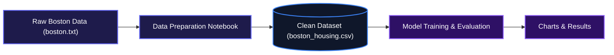
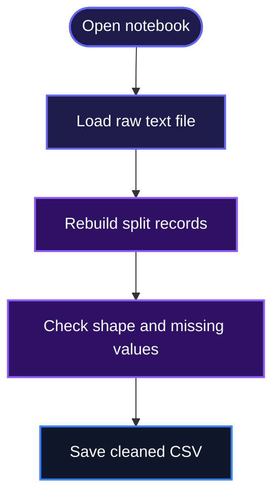
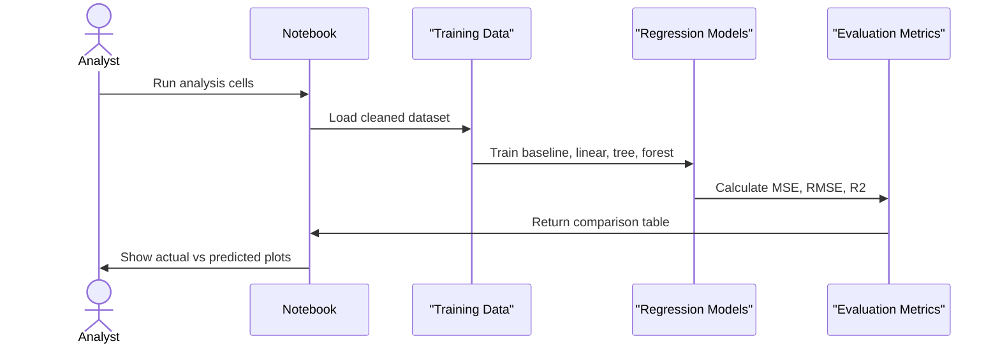

# Boston House Price Analysis

This project helps analysts and developers predict median home values in Boston-area census tracts from historical housing data. It walks through cleaning a raw two-line-per-record dataset, training several regression models, and comparing their performance with clear metrics and charts.

## System Design



## Features

- **Raw data reconstruction**: The notebook loads `./boston.txt` and rebuilds each record from its original two-line format into a clean 506 x 14 table, then saves it as `boston_housing.csv`.
- **Model training pipeline**: It trains a mean baseline, Linear Regression, Decision Tree, and Random Forest on an 80/20 train-test split with a fixed random seed.
- **Cross-validation comparison**: It evaluates every model with shuffled 5-fold cross-validation so the winner is not just the result of one lucky split.
- **Reproducible reporting**: It exports a results table and saves actual-vs-predicted and CV-comparison charts to the `images/` folder.

### Data preparation workflow



### Model training and evaluation workflow



## Installation

1. Clone the repository:

```bash
git clone https://github.com/Adeyiwolasuccess/Codveda_Internship.git
cd Codveda_Internship
```

2. Make sure Python 3.8 or newer is installed.
3. Install the required packages:

```bash
pip install pandas numpy scikit-learn matplotlib jupyter
```

## Usage

1. Start Jupyter Notebook:

```bash
jupyter notebook
```

2. Open `./House_Price_Analysis.ipynb` and run the cells from top to bottom.
3. The notebook will:
   - read `./boston.txt`
   - create `./boston_housing.csv`
   - train and compare four models
   - save `results_table.csv`
   - save charts to `images/actual_vs_predicted.png` and `images/cv_comparison.png`

After running the notebook, the final results table will look like this:

```text
                     MSE  RMSE  R2 (test)  CV R2 mean  CV R2 std
Baseline (mean)    75.05  8.66     -0.023      -0.011      0.007
Linear Regression  22.78  4.77      0.689       0.712      0.031
Decision Tree       8.98  3.00      0.878       0.729      0.131
Random Forest       8.01  2.83      0.891       0.871      0.031
```

The Random Forest comes out on top, with a typical prediction error of around $2,830 on median home values.

## Technologies Used

| Technology | Description |
|---|---|
| [Python](https://www.python.org/) | Core language for data processing and modeling |
| [pandas](https://pandas.pydata.org/) | Data loading, cleaning, and tabular analysis |
| [NumPy](https://numpy.org/) | Numerical operations and array handling |
| [scikit-learn](https://scikit-learn.org/) | Regression models, cross-validation, and metrics |
| [Matplotlib](https://matplotlib.org/) | Visualization of predictions and model comparisons |
| [Jupyter Notebook](https://jupyter.org/) | Interactive analysis environment |

## Contributing

Contributions are welcome. If you want to add a new model, improve the visualizations, or clean up the data pipeline, feel free to open an issue or pull request. Keep changes focused and include a short explanation of what you changed and why.

## Author

- LinkedIn: [Success Adeyiwola](https://linkedin.com/in/successadeyiwola)
- X: [jathom48](https://x.com/jathom48)

## Badges

[](https://www.python.org/)
[](https://pandas.pydata.org/)
[](https://scikit-learn.org/)
[](https://matplotlib.org/)
[](https://jupyter.org/)

[](https://dokugen.samueltuoyo.com)