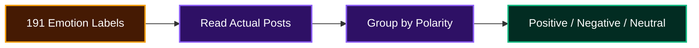
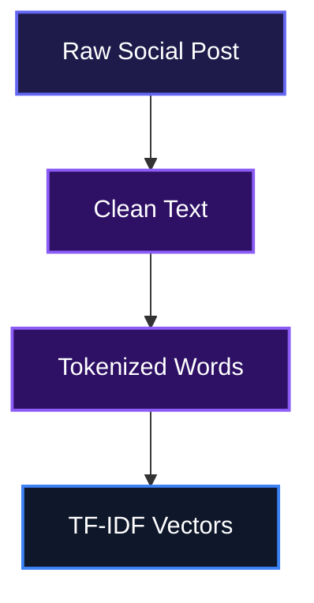
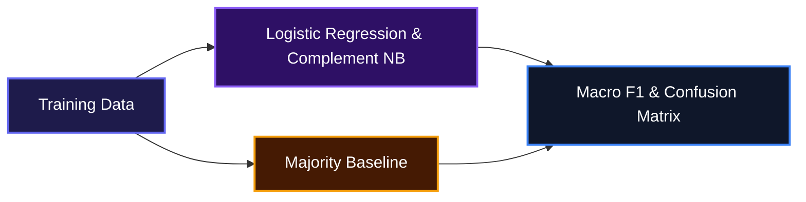

# NLP Sentiment Classification: Social Media Sentiment

A notebook-based pipeline that turns messy, emotion-labeled social media posts into clean Positive / Negative / Neutral sentiment predictions.

## Overview

This project helps developers classify short social media posts into Positive, Negative, or Neutral sentiment. It takes raw emotion-labeled text, cleans and restructures the labels into three polarity groups, then trains and compares classical classifiers so teams can see which approach works best on their data.

## System Architecture


## Features

### 1. Emotion-to-polarity label mapping

The raw dataset uses 191 distinct emotion labels. The notebook maps them into Positive, Negative, and Neutral classes by reading the actual post text, not just the label name. This makes the final target reliable enough to train on.



### 2. Text preprocessing

Short posts are normalized so models focus on sentiment rather than noise. Emojis are converted to words, hashtags are split, URLs are removed, stopwords are trimmed while preserving negations, and words are lemmatized.



### 3. Model training and evaluation

Logistic Regression and Complement Naive Bayes are trained on TF-IDF features and compared against a majority-class baseline. The notebook reports accuracy, per-class precision/recall, macro F1, and a confusion matrix.



### 4. Cross-validation

A stratified 5-fold cross-validation setup checks whether bigrams help and confirms the models generalize beyond one random split.

## Installation

1. Clone the repository:

```bash
git clone https://github.com/Adeyiwolasuccess/Codveda_Internship.git
cd Codveda_Internship
```

2. Install the required Python packages:

```bash
pip install pandas numpy matplotlib seaborn scikit-learn nltk emoji
```

3. Download the NLTK resources the notebook needs:

```python
import nltk
nltk.download("stopwords")
nltk.download("wordnet")
```

## Usage

Open the notebook:

```bash
jupyter notebook ./nlp_sentiment_classification.ipynb
```

Set the path to your dataset in the first code cell:

```python
DATA_PATH = "Sentiment_dataset.csv"
```

Run all cells top to bottom. The notebook handles data cleaning, label grouping, train/test splitting, vectorization, model training, evaluation, and cross-validation.

## Technologies Used

| Technology | Purpose | Link |
|---|---|---|
| Python | Core language | [python.org](https://www.python.org/) |
| Jupyter Notebook | Interactive analysis | [jupyter.org](https://jupyter.org/) |
| pandas | Data manipulation | [pandas.pydata.org](https://pandas.pydata.org/) |
| NumPy | Numerical computing | [numpy.org](https://numpy.org/) |
| scikit-learn | Models, metrics, and cross-validation | [scikit-learn.org](https://scikit-learn.org/) |
| NLTK | Stopwords and lemmatization | [nltk.org](https://www.nltk.org/) |
| emoji | Emoji-to-text conversion | [pypi.org/project/emoji](https://pypi.org/project/emoji/) |
| matplotlib | Charting | [matplotlib.org](https://matplotlib.org/) |
| seaborn | Statistical visualizations | [seaborn.pydata.org](https://seaborn.pydata.org/) |

## Contributing

Contributions are welcome. If you spot a bug, have an idea for a cleaner label mapping, or want to experiment with a transformer-based model, open an issue or pull request. Please keep changes focused and include a short description of what you changed.

## Author

- LinkedIn: [https://linkedin.com/in/successadeyiwola](https://linkedin.com/in/successadeyiwola)
- X (Twitter): [https://x.com/jathom48](https://x.com/jathom48)

## Badges

[](https://www.python.org/)
[](https://jupyter.org/)
[](https://scikit-learn.org/)
[](https://www.nltk.org/)
[](https://pandas.pydata.org/)
[](https://numpy.org/)

[](https://dokugen.samueltuoyo.com)